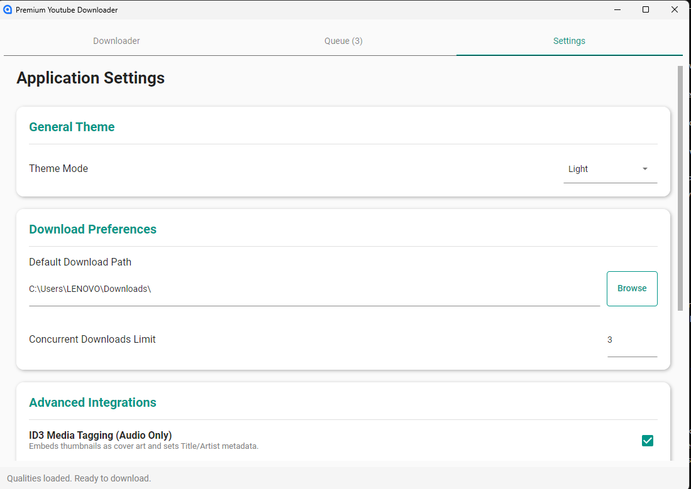
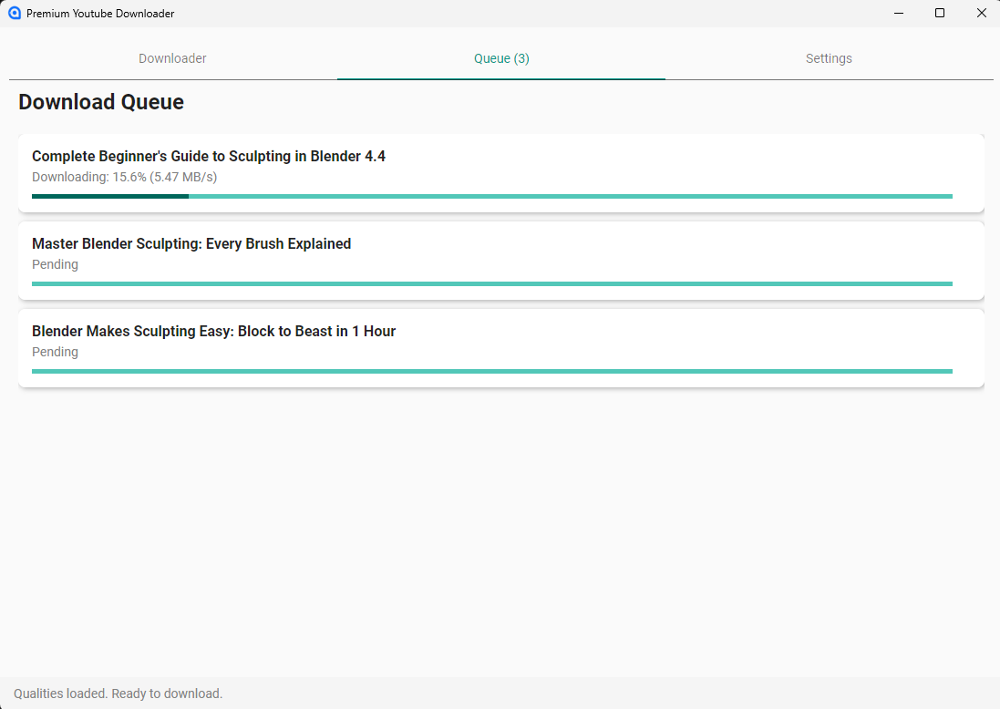
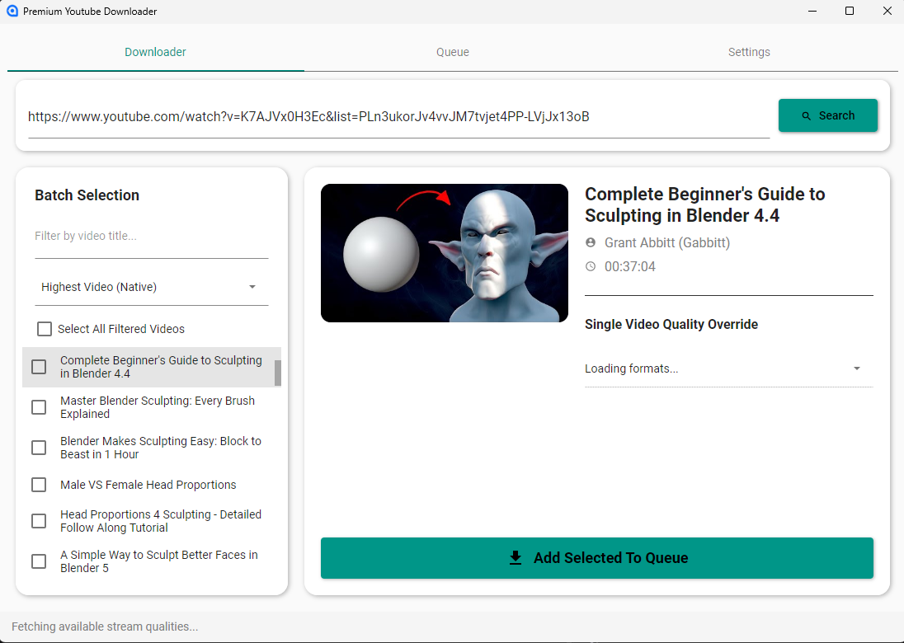
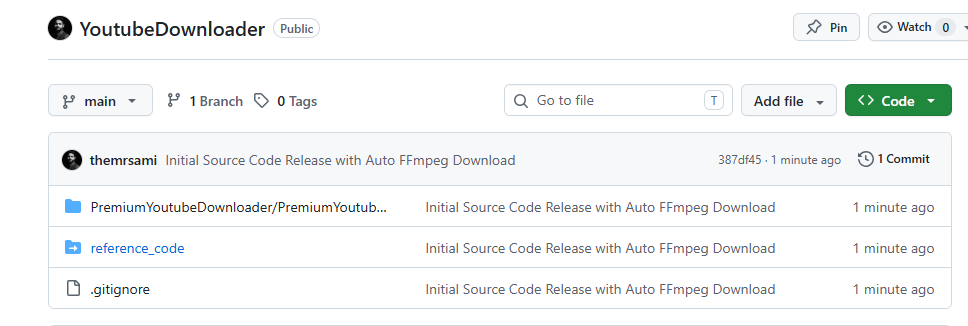
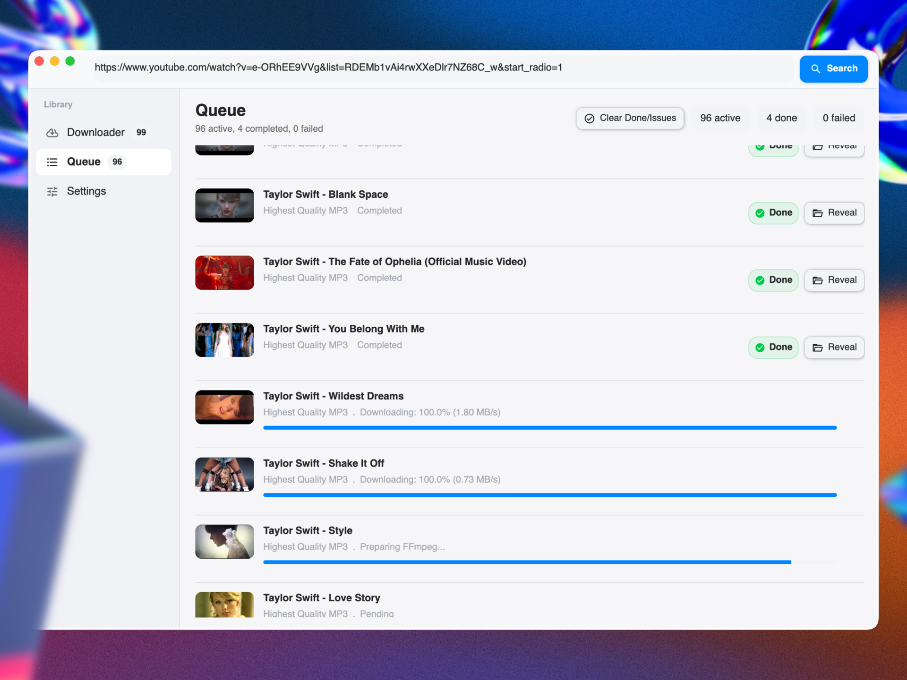
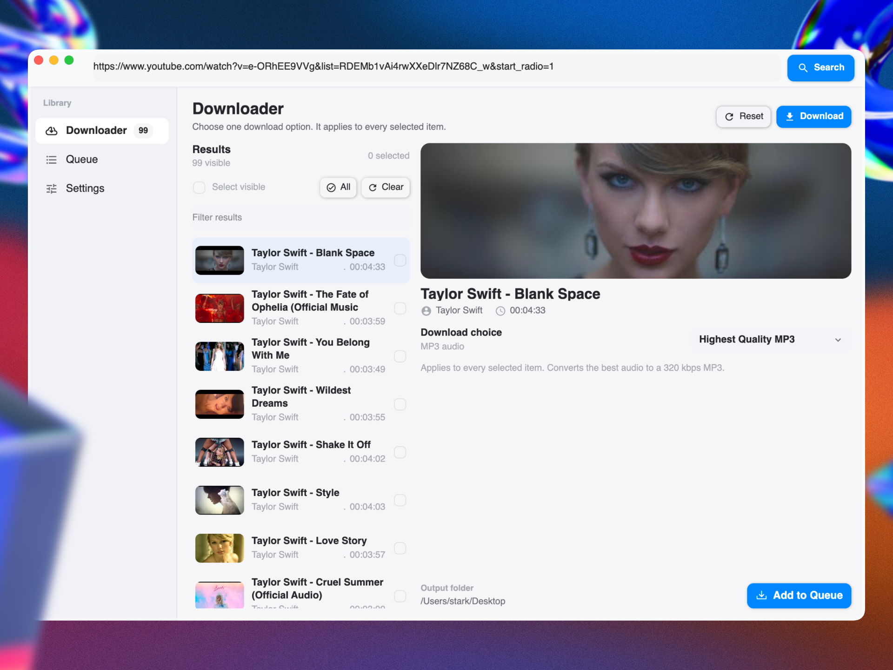
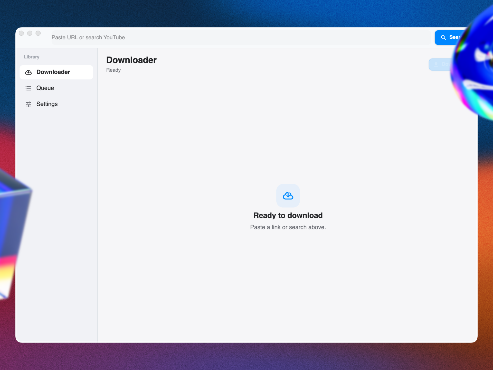

<!-- README.md -->
<div align="center">
  
  
  
  
  

  <h1>🚀 Premium YouTube Downloader</h1>
  <p><strong>An advanced, lightning-fast desktop application to download YouTube videos, playlists, and channels in maximum quality.</strong></p>
  <p><i>Developed by <b>fullstackusama</b></i></p>
</div>

<hr/>

## 🌟 Overview

**Premium YouTube Downloader** is a highly optimized, feature-rich desktop application designed for users who demand the highest video quality, advanced FFmpeg integrations, and a sleek, premium User Interface. 

Built with performance in mind, this tool bypasses standard API limitations to deliver blazing-fast multi-threaded downloads, native 4K/8K stream merging, and flawless subtitle embedding—all wrapped in a beautiful modern design.

## ✨ Key Features

- **🔥 Ultra-Fast Multi-Threaded Engine:** Maximize your bandwidth with chunked downloading and 1–6 simultaneous downloads. Live speed, size and time-remaining indicators for every item in your queue.
- **🎥 4K / 8K Native Support:** "Best Video" merges the highest available separated video and audio streams using an integrated FFmpeg pipeline, copying streams instead of re-encoding whenever possible.
- **📝 Advanced Subtitle Embedding:** Saves captions as SRT beside the video, or embeds them as a selectable track in the video file, preferring uploader-written captions over auto-generated ones.
- **🎨 Premium Dark UI:** A stunning, glassmorphic Avalonia UI with real-time progress bars, thumbnail previews, and granular quality selection.
- **🎶 Audio Extraction:** One-click pristine audio extraction (MP3) with automatic ID3 tagging and album art generation.
- **⚙️ Deep Customization:** Global quality preferences, local overrides, customizable download paths, and more.

## 📸 Screenshots

<div align="center">
  
  
  <br/>
  
  
</div>

## 📥 Installation

You can download the pre-compiled, self-contained Windows portable executable directly from the Releases page, or clone the repository to build from source.

1. Go to the [Releases Tab](../../releases/latest).
2. Download the latest `PremiumYoutubeDownloader.exe`.
3. Double-click to run! (No installation required—it's a portable executable).

Build the portable Windows executable from source (requires the .NET 8 SDK):

```powershell
./build-windows.ps1              # win-x64
./build-windows.ps1 -Runtime win-arm64
```

The executable is written to `artifacts/windows/<runtime>/`.

### macOS

<div align="center">
  
  
  
</div>

<br/>

Build a self-contained macOS app bundle from source:

```bash
chmod +x build-macos.sh
./build-macos.sh
```

On Apple Silicon, the app is created at `artifacts/macos/osx-arm64/Premium YouTube Downloader.app`. On Intel Macs, the default target is `osx-x64`. You can also pass the runtime explicitly:

```bash
./build-macos.sh osx-arm64
./build-macos.sh osx-x64
```

The script also writes a distributable `PremiumYoutubeDownloader-<version>-<runtime>.zip` next to the app bundle and stamps the bundle with the version from `version.json`.

**FFmpeg on macOS:** the app uses FFmpeg from Homebrew or MacPorts when it is installed (`brew install ffmpeg`), even when launched from Finder. Otherwise it downloads FFmpeg automatically on first launch. That automatic download is an Intel build, so Apple Silicon Macs need Rosetta (`softwareupdate --install-rosetta`); installing FFmpeg with Homebrew avoids this.

## 💡 How to Use

1. **Paste your URL:** Paste (or drag and drop) a single video, playlist or channel link into the top search bar, or type a search. `Ctrl+L` (`⌘L` on macOS) jumps to the search bar.
2. **Select Quality:** Use the global dropdown to choose MP3, Best Video (up to 8K), 1080p, 720p or YouTube's native combined stream.
3. **Queue & Download:** Hit "Add to Queue" and watch the ultra-fast FFmpeg engine handle the heavy lifting! Large playlists and channels keep loading in the background; press "Stop" to keep the results loaded so far.

## 📁 Where the app keeps its files

| | Windows | macOS |
|---|---|---|
| Settings, queue and FFmpeg | `%LOCALAPPDATA%\PremiumYoutubeDownloader` | `~/Library/Application Support/PremiumYoutubeDownloader` |
| Log file (for bug reports) | `…\PremiumYoutubeDownloader\logs\app.log` | `…/PremiumYoutubeDownloader/logs/app.log` |
| Default download folder | Downloads | Downloads |

Older Windows builds stored `settings.json`, `download-queue.json` and FFmpeg next to the executable. They are still picked up from there, so upgrading keeps your settings and queue.

## 🛠️ Technology Stack

- **Core Engine:** C# / .NET 8
- **UI Framework:** Avalonia UI (XAML)
- **Video Extraction:** YoutubeExplode
- **Media Processing:** Xabe.FFmpeg

<hr/>

<div align="center">
  <p>Copyright © 2026 fullstackusama. All Rights Reserved.</p>
</div>
